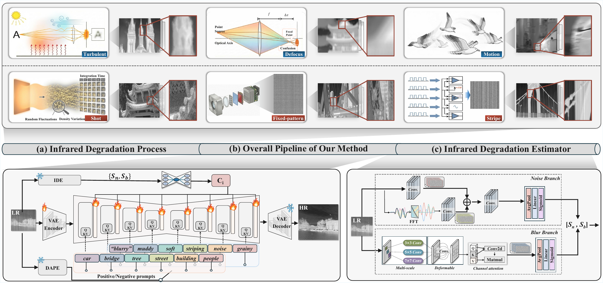

<div align="center">

# DIRSR

### Degradation-aware Infrared Image Super-Resolution

**Jinyuan Liu · Bin Zhang · Liming Zhang · Xinwei Xue · Zhiying Jiang · Xingyuan Li**

**IEEE Transactions on Image Processing — Accepted**

[Quick Start](#quick-start) · [Data Preparation](#data-preparation) · [Training](#training) · [Evaluation](#evaluation) · [References](#references)

</div>

DIRSR combines infrared degradation estimation, semantic guidance, and physics-informed region-aware optimization for **×4 infrared image super-resolution**.

<p align="center">
  
</p>

## Quick Start

### Step 1 · Install

Use Linux with an NVIDIA GPU and a compatible CUDA driver.

```bash
git clone https://github.com/binbin1021/DIRSR.git
cd DIRSR
conda env create -f environment.yml
conda activate dirsr
```

### Step 2 · Configure paths

Edit `configs/inference.json` to set the model, input, and output paths. Model weights are not bundled with this repository.

- `lr_dir`: input LR images; default `data/test/LR`.
- `output_dir`: restored images; default `outputs/SR`.
- Model paths: DIRSR SR checkpoint, matching IDE checkpoint, SD-Turbo, RAM, and DAPE.

The BERT tokenizer is included in `bert/`. Use the complete [SD-Turbo model directory](https://huggingface.co/stabilityai/sd-turbo); DAPE requires both the RAM base model and its adapter weights. Official sources are listed [below](#references).

### Step 3 · Run inference

```bash
python scripts/infer.py --config configs/inference.json --gpu 0
```

- Inputs: files with lowercase `.png`, `.jpg`, or `.jpeg` extensions in one folder.
- Outputs: ×4 PNG images. Use a fresh output directory to avoid filename conflicts.
- Optional check: append `--dry-run` to list missing files before running.

## Data Preparation

- [M³FD](https://github.com/JinyuanLiu-CV/TarDAL)
- [HM-TIR](https://github.com/Zihang-Chen/HM-TIR)

For SR training, organize paired images and foreground masks as follows:

```text
data/
├── train/
│   ├── HR/
│   ├── LR/
│   └── mask/
├── val/
│   ├── HR/
│   ├── LR/
│   └── mask/
└── test/
    ├── LR/
    └── HR/
```

1. Match the relative filenames, including extensions, across HR, LR, and masks.
2. Keep masks at HR resolution; HR width and height must be 4× those of LR.
3. Set the dataset paths in `configs/train.json`.

To generate LR images:

```bash
python data_tools/make_lr.py --input-dir data/train/HR --output-dir data/train/LR --seed 42
```

Adjust degradation settings in `data_tools/degradation_default.json`.

## Training

### DIRSR

Continue training from the SR checkpoint configured in `configs/train.json`. IDE and DAPE remain frozen.

```bash
python scripts/train.py --config configs/train.json --gpu 0
```

Use `--dry-run` to check paths, or `--resume` with a complete saved training state to resume a run. Masks are required; mask generation is not included.

### IDE

IDE training follows the degradation-degree learning scheme of [MM-RealSR](https://github.com/TencentARC/MM-RealSR). The required upstream code is included in [`MM-RealSR/`](MM-RealSR).

1. Set a compatible legacy IDE checkpoint as `warm_start` in `configs/ide.json`.
2. Prepare `outputs/ide_training/data_manifest/train.txt` and `val.txt`, each containing one absolute HR image path per line.
3. Run:

```bash
python training/ide/train_ide.py --config configs/ide.json --device cuda:0
```

### DAPE

DAPE follows [SeeSR](https://github.com/cswry/SeeSR). Use its official [DAPE training instructions](https://github.com/cswry/SeeSR#step3-training-for-dape) and [configuration](https://github.com/cswry/SeeSR/blob/main/basicsr/options/dape.yaml). The standalone DAPE training script is maintained in SeeSR.

## Evaluation

```bash
python scripts/evaluate.py --sr outputs/SR --hr data/test/HR --device cuda:0
```

Match SR and HR filenames, extensions, and image sizes. The evaluator reports **PSNR/SSIM on Y** and **LPIPS/DISTS on RGB**.

## References

| Component | Official source |
| --- | --- |
| SD-Turbo backbone | [Hugging Face](https://huggingface.co/stabilityai/sd-turbo) |
| DAPE architecture and training | [SeeSR](https://github.com/cswry/SeeSR) · [DAPE weights](https://huggingface.co/CSWRY/SeeSR/blob/main/DAPE.pth) |
| IDE degradation-degree learning | [MM-RealSR](https://github.com/TencentARC/MM-RealSR) |
| RAM base model | [GitHub](https://github.com/xinyu1205/recognize-anything) · [Weights](https://huggingface.co/xinyu1205/recognize_anything_model/blob/main/ram_swin_large_14m.pth) |

We also thank [S3Diff](https://github.com/ArcticHare105/S3Diff) and [BasicSR](https://github.com/XPixelGroup/BasicSR) for their open-source implementations.

## Citation

If this work helps your research, please cite:

> Jinyuan Liu, Bin Zhang, Liming Zhang, Xinwei Xue, Zhiying Jiang, and Xingyuan Li. **Degradation-aware Infrared Image Super-Resolution.** *IEEE Transactions on Image Processing*, accepted.
